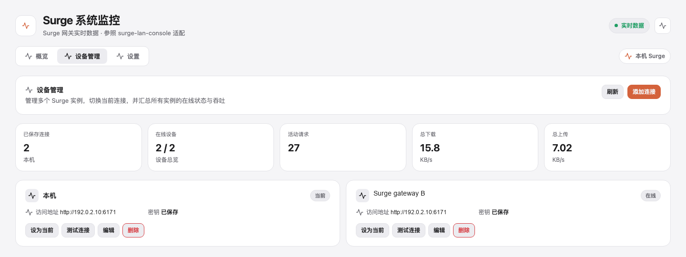
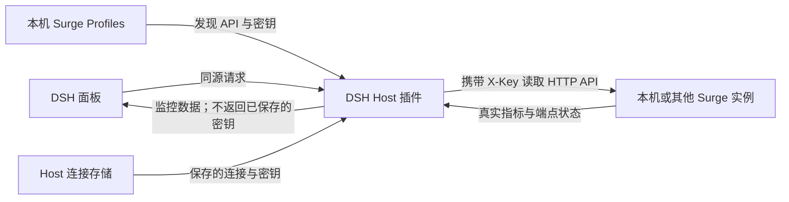

# Surge 系统监控面板

把 Surge 的实时流量、多实例状态和 API 诊断放进 DeepSeek Harness。

这是一个 DSH 原生插件，参照 `surge-lan-console` 的监控体验适配。面板直接读取 Surge HTTP API，支持概览、设备管理和设置三个页签，不需要另起一个前端服务。


> 上图来自实际运行截图，已裁去个人侧边栏，并以实色覆盖设备名称、内网地址、代理节点名称及事件详情。设备地址替换为文档示例地址，流量曲线和统计值保留截图原样。下方浅色图片来自已有布局检查素材，仅用于说明界面组织，不代表实时监测结果或当前版本的完整交互状态。

## 能做什么

| 页签 | 主要能力 |
| --- | --- |
| **概览** | 下载 / 上传速度、会话流量、运行时长、活动连接、流量趋势、LAN 设备、网络环境、节点流量、最近事件 |
| **设备管理** | 添加、编辑、删除多个 Surge 连接；测试连通性、切换当前实例；汇总在线状态、活动请求与吞吐 |
| **设置** | 跟随系统 / 浅色 / 深色外观、轮询间隔、趋势采样点数、设备与事件显示上限、暂停刷新、逐端点 API 诊断 |

- **本机自动发现**：Host 从 macOS 的 Surge Profiles 目录读取 HTTP API 配置，本机连接固定保留。
- **真实数据反馈**：端点失败时显示不可用，或保留带时间标记的上次成功数据；不会把采集失败当作零流量。
- **趋势随连接隔离**：打开面板后开始采样，切换连接或修改连接配置后重新记录，不混用不同实例的数据。
- **事件更易读**：相同级别、相同文本的事件合并计数，长消息单行省略，悬停查看全文。
- **中英文界面**：包含中文和英文文案；其他界面语言回退为英文。

## 界面导览

### 概览：先看流量，再定位设备与节点

顶部指标条展示当前连接的关键指标；下方流量图记录面板打开后的采样，横轴最多保留六个时间刻度。设备卡片展示 LAN 客户端，节点流量按会话流量排列，最近事件辅助判断异常。

概览里的「设备总览」指当前 Surge 下的 LAN 客户端；设备管理里的 Fleet 指多个 Surge 实例，两者统计对象不同。

### 设备管理：把多个 Surge 实例放在一起



每个保存的连接可以独立测试，并设为概览与诊断的当前数据源。Fleet 汇总始终覆盖本机和所有保存的连接，在进入页签或手动刷新时更新，并发探测最多四个实例。

> 这张布局示意保留了早期素材中的按钮排列。当前实现中，本机连接可切换、测试，但不可编辑或删除；图中的地址是不可用于实际连接的文档示例地址。

### 设置：调整刷新节奏，检查端点状态


外观设置只作用于本面板。自动采样仅在面板挂载、页面可见且未暂停时运行；上次请求结束后再安排下一次，避免慢接口导致请求堆积。

遇到数据缺失时，可在「设置 → API 诊断」查看各端点的状态、延迟和响应结构，再判断是连接问题、证书问题，还是 Surge 版本提供的接口不同。

## 安装与首次使用

### 1. 准备环境

- 安装支持 Host / Web Client 插件的 [DeepSeek Harness](https://github.com/deepseek-ai/deepseek-harness)。
- 在要监控的 Surge 实例上启用 HTTP API，并确认运行 DSH Host 的机器可以访问它。
- 本机自动发现针对 macOS 的 `~/Library/Application Support/Surge/Profiles` 目录；其他实例通过「设备管理」手动添加。

本项目是 DSH 插件包，不能直接作为独立网页运行。仓库未声明最低 DSH 版本；不同 DSH / Surge 版本的实际兼容性需要在使用环境确认。

### 2. 获取插件并安装

```bash
git clone https://github.com/pc439527/dsh-surge-panel.git
cd dsh-surge-panel
```

在 DSH 的「插件 → 添加插件」中，使用这个仓库的**本地绝对目录**安装。包名为 `@local/dsh-surge-panel`。安装并启用后，从侧边栏打开「Surge 系统监控」。如果安装结果提示需要重启，按提示重启 DSH。

也可以让 DSH 助手通过 `plugin_manager` 安装这个本地目录。安装操作由 DSH 插件管理器完成，无需手工修改 profile 配置。

### 3. 连接 Surge

**本机**：面板会尝试读取 Surge Profiles 中的 `http-api` 配置，并使用回环地址访问 API。若未连接，先确认 HTTP API 已启用，再查看诊断结果。

**其他实例**：进入「设备管理 → 添加连接」，填写连接名称、协议、主机、端口、平台和 API 密钥，测试后保存，再点击「设为当前」。主机字段只填域名或 IP，端口单独填写；支持 IPv6。实际密钥只应填写到插件的连接表单中。

**HTTPS**：插件验证证书链与主机名。私有 CA 或自签证书场景可以填写 PEM 格式的 CA 证书；自动发现的本机 HTTPS 如果证书不受信任，可改为手动添加 HTTPS 连接并配置 CA。

## 数据流与隐私



| 内容 | 存储或处理方式 |
| --- | --- |
| 面板外观与刷新偏好 | 当前浏览器的 `localStorage` |
| 手动添加的连接、API Key、可选 CA 证书 | DSH Host 上的 `~/.dsh/surge-panel-connections.json` |
| 已保存的 API Key | 以明文 JSON 保存在 Host 文件中，文件权限为 `600`；不是加密 Vault |
| 浏览器连接列表 | 返回连接信息、CA 证书及 `hasKey` 标记，不返回已保存的 API Key |
| 手动输入的新密钥 | 在测试或保存时提交给 Host |

Surge 侧操作为只读监控；新增、编辑、删除连接只修改插件自己的存储。请将 API 开放在可信网络内，跨不可信网络访问时使用 HTTPS 或受控隧道。

发布图片均为重新编码、已扁平化的 PNG，不包含原始截图图层或源文件元数据。原始布局检查图片不纳入 Git 提交；文档中的 `192.0.2.0/24` 地址仅用于示例。

## 可靠性设计

当前版本为 **1.1.1**。

- **连接隔离**：配置变化会使旧缓存失效，取消或丢弃迟到响应，防止旧实例数据出现在新连接下。
- **有界请求**：Surge 响应设总时限并限制为 16 MiB；浏览器请求支持超时和卸载取消；提交体仅接受 JSON 对象，上限 64 KiB / 10 秒。
- **原子保存**：先写权限为 `600` 的独占临时文件，再重命名；成功后才更新内存。损坏的存储不会被静默覆盖。
- **共享缓存**：Host 合并并发采集；策略、模块、规则、配置成功结果缓存 60 秒，其他成功结果与失败结果缓存 1 秒，本机发现结果缓存 30 秒。
- **不完整结果明确展示**：可选端点失败不会伪装为空列表；Fleet 活动请求不完整时显示 `—`，吞吐仅汇总本次成功响应的实例。

## 常见问题

**为什么有些指标显示 `—`？**

该字段可能未由当前 Surge 版本提供，或对应端点读取失败。先查看 API 诊断；`—` 不表示数值为零。

**为什么曲线不是历史全天流量？**

曲线是面板打开后对当前连接采样得到的短期趋势。切换实例会清空采样，插件不提供后台历史数据库。

**为什么手动添加连接后没有出现在概览？**

保存连接与切换当前连接是两个动作。在设备管理中将目标连接「设为当前」，概览与诊断才会切换。

**是否可以切换 Surge 策略、开启 MitM 或 Rewrite？**

当前插件提供只读监控和连接管理，不包含这些控制能力，也不内嵌独立 Node Core、SQLite、系统通知、后台自动化、加密 Vault 或伪造数据的演示模式。

## 开发与验证

插件运行时使用 Node.js 内置模块和 DSH 提供的 React / UI 服务，没有额外的 npm 运行时依赖。

```bash
npm run check
npm test
```

`check` 校验 Host 与 Client JavaScript 语法；测试使用隔离存储和传输替身，不读取真实密钥、不访问真实 Surge。它们不验证浏览器布局、真实 TLS 握手或全部 Surge 版本的兼容性。

| 文件 | 用途 |
| --- | --- |
| [index.js](index.js) | Host 侧 API 代理、连接存储、发现、采集与缓存 |
| [client.js](client.js) | 三个页签、图表、连接表单与诊断 UI |
| [cordis.patch.yml](cordis.patch.yml) | DSH 插件装配入口 |
| [locale/](locale/) | 插件元数据的中英文资源 |
| [tests/regression.test.mjs](tests/regression.test.mjs) | 回归测试 |
| [中文详细说明](docs/DETAIL.zh.md) · [English details](docs/DETAIL.md) | 功能、可靠性改进与实现边界 |

## 致谢

监控体验参照 `surge-lan-console` 适配；DSH 原生实现与功能边界见上文。Surge 为其所属方的产品，本仓库为第三方适配插件。

本文档及发布素材使用 DeepSeek Harness 整理。

[](https://github.com/deepseek-ai/deepseek-harness)
