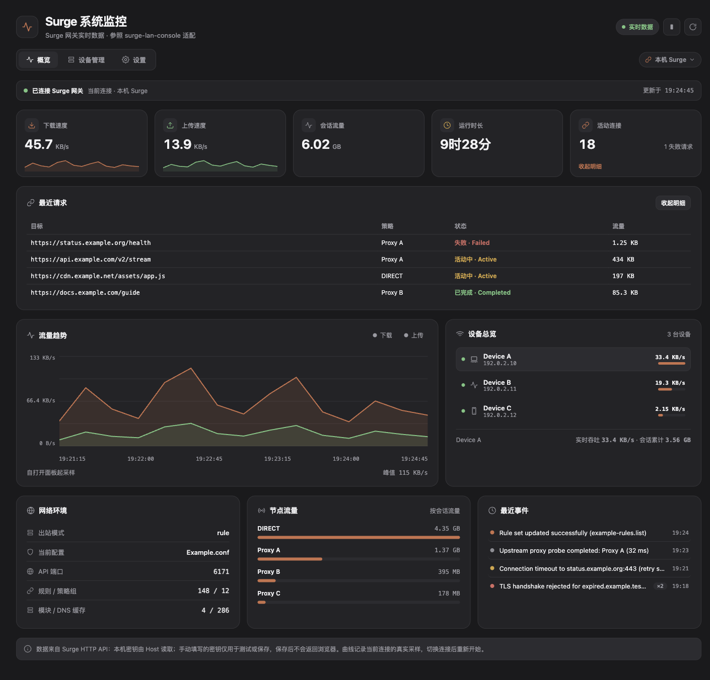
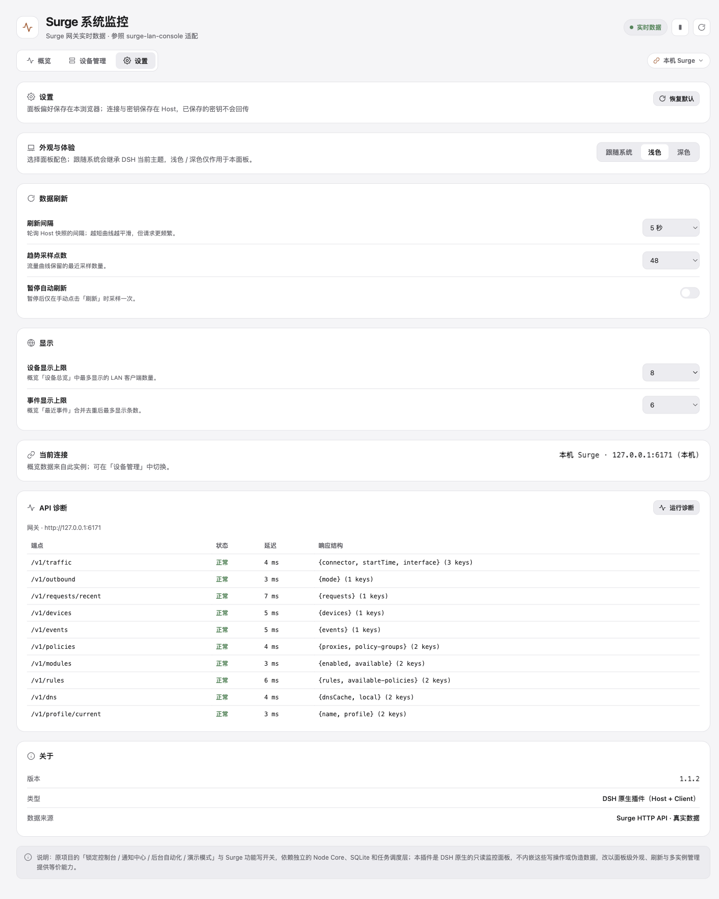
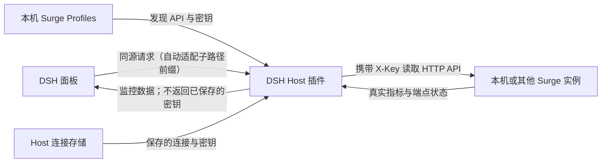

# Surge 系统监控面板

把 Surge 的实时流量、多实例状态和 API 诊断放进 DeepSeek Harness。

这是一个 DSH 原生插件，参照 `surge-lan-console` 的监控体验适配。面板直接读取 Surge HTTP API，支持概览、设备管理和设置三个页签，不需要另起一个前端服务。




> 本文档中的三张预览图均直接由 `v1.1.2` 插件前端使用 RFC 5737 示例地址（`192.0.2.0/24`、`198.51.100.0/24`）和 RFC 2606 示例域名渲染，并经重新编码与扁平化去除元数据，不含任何真实设备、内网地址或密钥。

## 能做什么

| 页签 | 主要能力 |
| --- | --- |
| **概览** | 下载 / 上传速度、会话流量、运行时长、活动连接与可展开「最近请求」明细、带 Y 轴刻度与悬浮提示的流量趋势图、按实时速率排序的 LAN 设备总览、网络环境、节点流量、可展开最近事件 |
| **设备管理** | 添加、编辑、删除多个 Surge 连接（支持「保存并设为当前」与 `Enter`/`Esc` 快捷键）；卡片内联连通性测试；本机与远程多实例 Fleet 在线状态、延迟、活动请求与吞吐汇总 |
| **设置** | 跟随系统 / 浅色 / 深色外观、轮询间隔、趋势采样点数、设备与事件显示上限、暂停刷新、当前连接摘要、逐端点 API 诊断与恢复默认 |

- **顶栏快捷操作**：右上角提供「当前连接」快速切换弹窗、自动刷新暂停/恢复按钮与带加载态的手动刷新按钮。
- **本机自动发现**：Host 从 macOS 的 Surge Profiles 目录按配置修改时间优先读取 HTTP API 配置，本机连接固定保留，并展示真实的在线/离线状态、延迟与吞吐。
- **真实数据反馈**：端点失败时显示不可用，或保留带时间标记的上次成功数据；离线时依然保留当前连接摘要，不会把采集失败当作零流量。
- **趋势随连接隔离**：打开面板后开始采样，切换连接或修改连接配置后重新记录，不混用不同实例的数据。
- **事件更易读**：相同级别、相同文本的事件合并计数（`×N`），长消息单行省略，点击即可展开查看全文。
- **fnOS 子路径网关兼容**：前端自动识别 `window.__FNOS_GATEWAY_CONFIG__.prefix` 与 `<base href>` 前缀，在 fnOS（`/app/fn-deepseek-harness`）等反向代理子路径部署下 `/surge-api/*` 零配置直通。
- **中英文界面**：Host 返回结构化错误码，前端按当前语言本地化展示；包含中文和英文文案，其他语言回退为英文。

## 界面导览

### 概览：先看流量，再定位设备、请求与节点

顶部指标条展示当前连接的关键指标，点击「活动连接」卡片中的「查看明细」可展开「最近请求」表格（按失败 → 活跃 → 完成排序）。流量趋势图提供 Y 轴刻度、悬浮十字准星与数值提示，且量程随当前可见曲线动态调整，统一采用二进制速率换算（B/s ~ GB/s）。LAN 设备按实时速率与总流量排序并在行内展示实时速率；节点流量按会话流量排列；最近事件支持去重与点击展开。

概览里的「设备总览」指当前 Surge 下的 LAN 客户端；设备管理里的 Fleet 指多个 Surge 实例，两者统计对象不同。

### 设备管理：把多个 Surge 实例放在一起


每个连接卡片可独立执行连通性测试，测试结果内联展示在对应卡片内并区分成功/失败语义色。本机 Surge 卡片接入实时 Fleet 状态（在线/离线、访问地址、延迟、吞吐与错误原因），可切换与测试，不可编辑或删除。新增或编辑连接采用原生表单，支持客户端前置校验、`Enter` 提交、`Esc` 取消以及「保存并设为当前」；删除确认使用危险态「确认删除」按钮，若删除正在编辑的连接会自动关闭表单。

### 设置：调整刷新节奏，检查端点状态



外观设置只作用于本面板（浅色模式主按钮对比度已按 WCAG AA 校准）。自动采样仅在面板挂载、页面可见且未暂停时运行；上次请求结束后再安排下一次，避免慢接口导致请求堆积。点击「恢复默认」后会展示确认反馈。

遇到数据缺失时，可在「设置 → API 诊断」查看全部 10 个端点的状态、延迟和响应结构（窄屏支持横向滚动），快速定位连接、证书或 Surge 版本差异问题。

## v1.1.2 更新摘要

- **fnOS 网关兼容**：`api()` 自动解析 `window.__FNOS_GATEWAY_CONFIG__.prefix` 及 `<base href>`，修复子路径反代场景下 `/surge-api/*` 404 问题，并已在 fnOS `fn-deepseek-harness` 实机部署验收。
- **核心缺陷修复（P0）**：收紧 `package.json` `files` 发布白名单（避免误打包未脱敏截图）；修复删除确认按钮文案与危险态样式并联动关闭编辑表单；本机 Surge 卡片接入真实 Fleet 状态与错误详情；提升浅色模式主按钮对比度（`#ffffff` on `#be4d27`）。
- **交互与图表升级（P1/P2）**：流量趋势图新增 Y 轴刻度、悬浮提示与可见曲线动态量程；新增顶栏暂停/恢复按钮、刷新加载旋转态、右上角连接快速切换弹窗、「保存并设为当前」以及可展开的「最近请求」表格；设备列表改用稳定 `key` 并按实时速率优先排序；测试结果内联至对应卡片；补齐 `tablist`/`tab`/`tabpanel` 方向键导航与表单键盘支持。
- **Host 健壮性与安全加固**：结构化错误码与前后端本地化；离线时保留当前连接信息；卸载时清理运行时缓存并限制响应缓存上限；删除不存在连接返回 `404`；CA 证书改用 `crypto.X509Certificate` 校验；拦截 IPv6 映射元数据地址（如 `::ffff:169.254.169.254`）；本机配置按修改时间降序优先发现；兼容 `HEAD` 请求。

## 安装与首次使用

### 1. 准备环境

- 安装支持 Host / Web Client 插件的 [DeepSeek Harness](https://github.com/deepseek-ai/deepseek-harness)。
- 在要监控的 Surge 实例上启用 HTTP API，并确认运行 DSH Host 的机器可以访问它。
- 本机自动发现针对 macOS 的 `~/Library/Application Support/Surge/Profiles` 目录；在 Linux / fnOS 等无本机 Surge 环境下，直接通过「设备管理」添加局域网或远程 Surge 实例即可。

本项目是 DSH 插件包，不能直接作为独立网页运行。仓库未声明最低 DSH 版本；不同 DSH / Surge 版本的实际兼容性需要在使用环境确认。

### 2. 获取插件并安装

#### 方式 A：桌面端 / 本机目录安装

```bash
git clone https://github.com/pc439527/dsh-surge-panel.git
cd dsh-surge-panel
```

在 DSH 的「插件 → 添加插件」中，使用这个仓库的**本地绝对目录**安装（包名为 `@local/dsh-surge-panel`），或让 DSH 助手通过 `plugin_manager` 安装该目录。安装并启用后，从侧边栏打开「Surge 系统监控」；若提示重启，按提示重启 DSH。

#### 方式 B：fnOS / 远程 DSH Web 打包安装（Tarball）

可从 GitHub Release 下载 `local-dsh-surge-panel-1.1.2.tgz`，或在本地执行 `npm pack` 生成发布包后上传到目标主机，通过 DSH CLI 安装到 `web` profile：

```bash
npm pack
# 将生成的 local-dsh-surge-panel-1.1.2.tgz 上传到目标主机后执行：
dsh plugin --profile web add /path/to/local-dsh-surge-panel-1.1.2.tgz
```

在 fnOS 上安装完成后，重启 `fn-deepseek-harness` 应用（例如在应用中心重启，或执行 `sudo appcenter-cli stop fn-deepseek-harness && sudo appcenter-cli start fn-deepseek-harness`），刷新浏览器即可在侧边栏看到「Surge 系统监控」。插件会自动适配 `/app/fn-deepseek-harness` 子路径前缀。

### 3. 连接 Surge

**本机**：面板会尝试按修改时间优先读取 Surge Profiles 中的 `http-api` 配置，并使用回环地址访问 API。若未连接，先确认 HTTP API 已启用，再查看「设置 → API 诊断」。

**其他实例**：进入「设备管理 → 添加连接」，填写连接名称、协议、主机、端口、平台和 API 密钥，可直接「测试连接」并点击「保存并设为当前」（或先「保存」后再手动切换）。主机字段只填域名或 IP，端口单独填写；支持 IPv6。实际密钥只应填写到插件的连接表单中。

**HTTPS**：插件使用 `crypto.X509Certificate` 校验可选 PEM CA 证书，并严格校验证书链与主机名。私有 CA 或自签证书场景可填写 PEM 格式 CA 证书；自动发现的本机 HTTPS 如果证书不受信任，可改为手动添加 HTTPS 连接并配置 CA。

## 数据流与隐私



| 内容 | 存储或处理方式 |
| --- | --- |
| 面板外观与刷新偏好 | 当前浏览器的 `localStorage` |
| 手动添加的连接、API Key、可选 CA 证书 | DSH Host 上的 `~/.dsh/surge-panel-connections.json` |
| 已保存的 API Key | 以明文 JSON 保存在 Host 文件中，文件权限为 `600`；不是加密 Vault |
| 浏览器连接列表 | 返回连接信息、CA 证书及 `hasKey` 标记，不返回已保存的 API Key |
| 手动输入的新密钥 | 在测试或保存时提交给 Host |

Surge 侧操作为只读监控；新增、编辑、删除连接只修改插件自己的存储。请将 API 开放在可信网络内，跨不可信网络访问时使用 HTTPS 或受控隧道。Host 同时拦截云元数据地址（含 `169.254.169.254` 及 IPv6 映射地址 `::ffff:169.254.169.254`）。

仓库中的预览图均为重新编码、已扁平化的 PNG，使用文档示例数据渲染，不包含真实环境信息或源文件元数据。`package.json` `files` 仅包含运行时必需文件与文档资源，本地布局检查图片与录制素材均被 `.gitignore` 排除且不进入发布包。

## 可靠性设计

当前版本为 **1.1.2**。

- **连接隔离**：配置变化会使旧缓存失效，取消或丢弃迟到响应，防止旧实例数据出现在新连接下；插件卸载时清理全部运行时缓存。
- **有界请求**：Surge 响应设总时限并限制为 16 MiB；浏览器请求支持超时和卸载取消；提交体仅接受 JSON 对象，上限 64 KiB / 10 秒；响应缓存具备条目上限淘汰。
- **原子保存**：先写权限为 `600` 的独占临时文件，再重命名；成功后才更新内存。损坏的存储不会被静默覆盖；删除不存在的连接返回 `404`。
- **共享缓存**：Host 合并并发采集；策略、模块、规则、配置成功结果缓存 60 秒，其他成功结果与失败结果缓存 1 秒，本机发现结果缓存 30 秒。
- **不完整结果明确展示**：可选端点失败不会伪装为空列表；Fleet 活动请求不完整时显示 `—`，吞吐仅汇总本次成功响应的实例。

## 常见问题

**为什么有些指标显示 `—`？**

该字段可能未由当前 Surge 版本提供，或对应端点读取失败。先查看「设置 → API 诊断」；`—` 不表示数值为零。

**为什么曲线不是历史全天流量？**

曲线是面板打开后对当前连接采样得到的短期趋势。切换实例会清空采样，插件不提供后台历史数据库。

**在 Linux / fnOS 上安装后为什么提示未发现本机 Surge？**

fnOS / Linux 宿主机通常未运行 Surge，因此默认「本机 Surge」处于离线态属于正常现象。点击「设备管理 → 添加连接」，填写局域网内 macOS / iOS Surge 的 HTTP API 地址与密钥并「保存并设为当前」即可。

**是否可以切换 Surge 策略、开启 MitM 或 Rewrite？**

当前插件提供只读监控和连接管理，不包含这些控制能力，也不内嵌独立 Node Core、SQLite、系统通知、后台自动化、加密 Vault 或伪造数据的演示模式。

## 开发与验证

插件运行时使用 Node.js 内置模块和 DSH 提供的 React / UI 服务，没有额外的 npm 运行时依赖。

```bash
npm run check
npm test
npm pack --dry-run
```

`check` 校验 Host 与 Client JavaScript 语法；`test` 运行 30 项回归测试（覆盖 Host 全路由、IPv6/SSRF 拦截、X509 CA 校验、本机发现排序、设备排序与最近请求、中英词典/版本号/打包清单一致性等），使用隔离存储和传输替身，不读取真实密钥、不访问真实 Surge。

| 文件 | 用途 |
| --- | --- |
| [index.js](index.js) | Host 侧 API 代理、连接存储、发现、采集与缓存 |
| [client.js](client.js) | 三个页签、图表、连接表单、诊断 UI 与子路径前缀适配 |
| [cordis.patch.yml](cordis.patch.yml) | DSH 插件装配入口 |
| [locale/](locale/) | 插件元数据的中英文资源 |
| [tests/regression.test.mjs](tests/regression.test.mjs) | 回归测试 |
| [中文详细说明](docs/DETAIL.zh.md) · [English details](docs/DETAIL.md) | 功能、可靠性改进与实现边界 |

## 致谢

监控体验参照 `surge-lan-console` 适配；DSH 原生实现与功能边界见上文。Surge 为其所属方的产品，本仓库为第三方适配插件。

本文档及发布素材使用 DeepSeek Harness 整理。

[](https://github.com/deepseek-ai/deepseek-harness)
